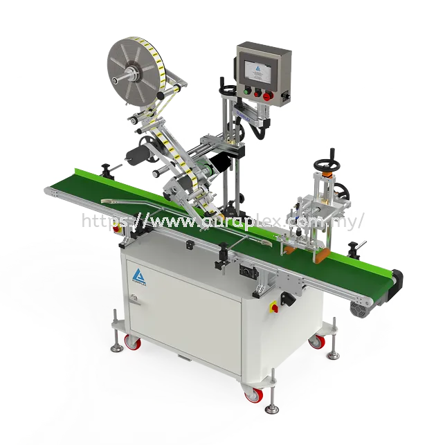
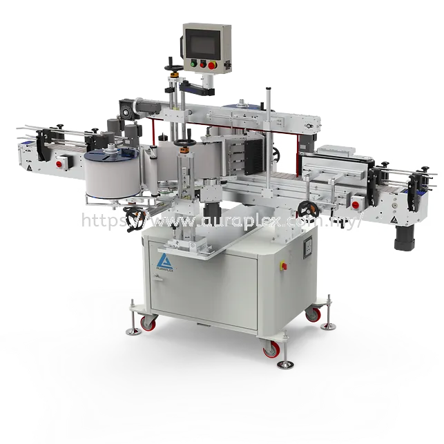

# Round 1 product image corrections

Prepared 2026-10-21 against upstream main at 730a875b207ed234f27eda7f6a535316082a131c.

Initial review: **Max + Senior AURAPLEX Staff**. Management approval: **Pending Friendy PR review**. Expert verification: **Pending Mr Kan where necessary**. Friendy's instruction to create a PR authorizes this proposal; it does not approve every recommendation in the review HTML. No exported Friendy approval JSON was found in the audit workspace, adjacent project folders or Downloads. No production changes have been made.

## Scope and evidence

This implementation changes 10 products: 35 Wrong Machine gallery references removed, 1 byte-identical gallery reference removed, and 1 cover reference replaced (37 reference operations; 36 gallery removals). Gallery entries decrease from 102 to 66. No cross-product additions, asset deletions, or category changes. All three existing categories and 30 product identities stay intact.

The V3.2 approval page contains the same 87 recommendations as version 2. Items 1 and 54–87 are implemented as proposals here. One additional removal is justified by identical SHA-256 bytes: Flat_Labelling_Machine_4.webp duplicates retained Flat_Labelling_Machine_2.webp. This preserves the confirmed-correct picture.

The original Round 1 export contains 94 Correct Machine, 56 Wrong Machine, 12 Not Sure, 0 Valid Customised Variant and 0 Not Reviewed. Selected decisions, association IDs, full image hashes, V3.2 item IDs, the exact baseline and before/after galleries are embedded in [changes.json](changes.json). Source file hashes:

| Source | SHA-256 |
|---|---|
| auraplex-image-review-round1-max-2026-10-09-1801.json | 28ae659d48f2c5737d57ce76df64caef5ea175b3c326321e49a3687416cf8238 |
| round1-friendy-approval-v3.2.html | b5bdb3bbbc51143277a4e0e75d3a20c5a2170cac2e9d6984d9236fba5a793d51 |
| round1-proposed-changes-v2.json | 120e2cad6dd36a63af4395f8ddc0abc6d80366a9865e911bfac68c2c081ea621 |
| round1-proposed-changes.json | 159e666daf06a0d5606062a9a739dd360c25070e51475c06f2d57e5ade356c04 |

The earlier Phase 1 worktree was an unpublished draft. Version 1's “already removed” labels are not treated as production evidence. This PR independently evaluates the effective catalogue on current upstream main, including REAL_IMAGES overrides. It does not copy the Phase 1 changes wholesale. The generated catalogue's external source manifests are unavailable, so the narrow correction layer lives in lib/catalog.ts. Original generated data and image files are preserved.

## Products

| Product / website | Category | Gallery before → after | Cover |
|---|---|---|---|
| [Semi Auto Wrap Around Labelling Machine](https://www.auraplex.info/en/products/semi-auto-wrap-around-labelling-machine) | labelling | 10 → 7 | Unchanged |
| [Print Apply Top Labelling Machine](https://www.auraplex.info/en/products/print-apply-top-labelling-machine) | labelling | 11 → 9 | Unchanged |
| [One Side Wrap Around Side Labelling Machine](https://www.auraplex.info/en/products/one-side-wrap-around-side-labelling-machine) | labelling | 5 → 3 | Unchanged |
| [Top Labelling Machine With Thermal Transfer Printer Auto Feeder](https://www.auraplex.info/en/products/top-labelling-machine-with-thermal-transfer-printer-auto-feeder) | labelling | 7 → 5 | Unchanged |
| [Flat Labelling Machine](https://www.auraplex.info/en/products/flat-labelling-machine) | labelling | 5 → 4 | Unchanged |
| [Top Labelling Machine With Thermal Transfer Printer Auto Feeder V2](https://www.auraplex.info/en/products/top-labelling-machine-with-thermal-transfer-printer-auto-feeder-v2) | labelling | 7 → 3 | Unchanged |
| [Customized Bottom Labelling Machine](https://www.auraplex.info/en/products/customized-bottom-labelling-machine) | labelling | 6 → 3 | Unchanged |
| [Egg Tray Labelling Machine](https://www.auraplex.info/en/products/egg-tray-labelling-machine) | labelling | 6 → 2 | Unchanged |
| [Two Side Labelling Machine With Corner Press](https://www.auraplex.info/en/products/two-side-labelling-machine-with-corner-press) | labelling | 10 → 3 | Two_Side_Labelling_Machine_with_Corner_Press_3.webp → Two_Side_Labelling_Machine_with_Corner_Press_2.webp |
| [Customized Top Labelling Machine](https://www.auraplex.info/en/products/customized-top-labelling-machine) | labelling | 13 → 5 | Unchanged |

## Cover preview: Two Side Labelling Machine With Corner Press

| Before: marked Wrong Machine | Proposed: Correct Machine + Suitable as Cover |
|---|---|
|  |  |

## Every reference change

Asset links show the actual repository files. A removal leaves the file available on disk. The cover replacement also moves the retained _2 image to the first gallery position. Rows count the old cover's gallery removal separately from its cover-reference replacement.

| Product / website | Original image | Updated image | Reason | Audit reference | Approval |
|---|---|---|---|---|---|
| [Two Side Labelling Machine With Corner Press](https://www.auraplex.info/en/products/two-side-labelling-machine-with-corner-press) | [Two_Side_Labelling_Machine_with_Corner_Press_3.webp](../../public/products/Two_Side_Labelling_Machine_with_Corner_Press_3.webp) | Removed from this product | Wrong Machine in human Round 1 | V3.2 #1; cover::two-side-labelling-machine-with-corner-press::b22281fc24603f4f | Pending Friendy |
| [Semi Auto Wrap Around Labelling Machine](https://www.auraplex.info/en/products/semi-auto-wrap-around-labelling-machine) | [Semi_Auto_Wrap_Around_Labelling_Machine_10.webp](../../public/products/Semi_Auto_Wrap_Around_Labelling_Machine_10.webp) | Removed from this product | Wrong Machine in human Round 1 | V3.2 #54; remove::semi-auto-wrap-around-labelling-machine::677acd8d9fa0176d | Pending Friendy |
| [Semi Auto Wrap Around Labelling Machine](https://www.auraplex.info/en/products/semi-auto-wrap-around-labelling-machine) | [Semi_Auto_Wrap_Around_Labelling_Machine_11.webp](../../public/products/Semi_Auto_Wrap_Around_Labelling_Machine_11.webp) | Removed from this product | Wrong Machine in human Round 1 | V3.2 #55; remove::semi-auto-wrap-around-labelling-machine::f09c6684c5dadb21 | Pending Friendy |
| [Semi Auto Wrap Around Labelling Machine](https://www.auraplex.info/en/products/semi-auto-wrap-around-labelling-machine) | [Semi_Auto_Wrap_Around_Labelling_Machine_13.webp](../../public/products/Semi_Auto_Wrap_Around_Labelling_Machine_13.webp) | Removed from this product | Wrong Machine in human Round 1 | V3.2 #56; remove::semi-auto-wrap-around-labelling-machine::e179d4cf45ba2cc5 | Pending Friendy |
| [Print Apply Top Labelling Machine](https://www.auraplex.info/en/products/print-apply-top-labelling-machine) | [Print_Apply_Top_Labelling_Machine_13.webp](../../public/products/Print_Apply_Top_Labelling_Machine_13.webp) | Removed from this product | Wrong Machine in human Round 1 | V3.2 #57; remove::print-apply-top-labelling-machine::3c821040f7d5b21c | Pending Friendy |
| [Print Apply Top Labelling Machine](https://www.auraplex.info/en/products/print-apply-top-labelling-machine) | [Print_Apply_Top_Labelling_Machine_14.webp](../../public/products/Print_Apply_Top_Labelling_Machine_14.webp) | Removed from this product | Wrong Machine in human Round 1 | V3.2 #58; remove::print-apply-top-labelling-machine::bedcd2d3ba46dea6 | Pending Friendy |
| [One Side Wrap Around Side Labelling Machine](https://www.auraplex.info/en/products/one-side-wrap-around-side-labelling-machine) | [One_Side_Wrap_Around_Side_Labelling_Machine_4.webp](../../public/products/One_Side_Wrap_Around_Side_Labelling_Machine_4.webp) | Removed from this product | Wrong Machine in human Round 1 | V3.2 #59; remove::one-side-wrap-around-side-labelling-machine::f9898e9826c34e91 | Pending Friendy |
| [One Side Wrap Around Side Labelling Machine](https://www.auraplex.info/en/products/one-side-wrap-around-side-labelling-machine) | [One_Side_Wrap_Around_Side_Labelling_Machine_7.webp](../../public/products/One_Side_Wrap_Around_Side_Labelling_Machine_7.webp) | Removed from this product | Wrong Machine in human Round 1 | V3.2 #60; remove::one-side-wrap-around-side-labelling-machine::a9713789ba6c8b5c | Pending Friendy |
| [Top Labelling Machine With Thermal Transfer Printer Auto Feeder](https://www.auraplex.info/en/products/top-labelling-machine-with-thermal-transfer-printer-auto-feeder) | [Top_Labelling_Machine_with_Thermal_Transfer_Printer_Auto_Feeder_1.webp](../../public/products/Top_Labelling_Machine_with_Thermal_Transfer_Printer_Auto_Feeder_1.webp) | Removed from this product | Wrong Machine in human Round 1 | V3.2 #61; remove::top-labelling-machine-with-thermal-transfer-printer-auto-feeder::bedcd2d3ba46dea6 | Pending Friendy |
| [Top Labelling Machine With Thermal Transfer Printer Auto Feeder](https://www.auraplex.info/en/products/top-labelling-machine-with-thermal-transfer-printer-auto-feeder) | [Top_Labelling_Machine_with_Thermal_Transfer_Printer_Auto_Feeder_6.webp](../../public/products/Top_Labelling_Machine_with_Thermal_Transfer_Printer_Auto_Feeder_6.webp) | Removed from this product | Wrong Machine in human Round 1 | V3.2 #62; remove::top-labelling-machine-with-thermal-transfer-printer-auto-feeder::3c821040f7d5b21c | Pending Friendy |
| [Top Labelling Machine With Thermal Transfer Printer Auto Feeder V2](https://www.auraplex.info/en/products/top-labelling-machine-with-thermal-transfer-printer-auto-feeder-v2) | [Top_Labelling_Machine_with_Thermal_Transfer_Printer_Auto_Feeder_v2_0.webp](../../public/products/Top_Labelling_Machine_with_Thermal_Transfer_Printer_Auto_Feeder_v2_0.webp) | Removed from this product | Wrong Machine in human Round 1 | V3.2 #63; remove::top-labelling-machine-with-thermal-transfer-printer-auto-feeder-v2::bedcd2d3ba46dea6 | Pending Friendy |
| [Top Labelling Machine With Thermal Transfer Printer Auto Feeder V2](https://www.auraplex.info/en/products/top-labelling-machine-with-thermal-transfer-printer-auto-feeder-v2) | [Top_Labelling_Machine_with_Thermal_Transfer_Printer_Auto_Feeder_v2_3.webp](../../public/products/Top_Labelling_Machine_with_Thermal_Transfer_Printer_Auto_Feeder_v2_3.webp) | Removed from this product | Wrong Machine in human Round 1 | V3.2 #64; remove::top-labelling-machine-with-thermal-transfer-printer-auto-feeder-v2::64ca78c7ac4b96ae | Pending Friendy |
| [Top Labelling Machine With Thermal Transfer Printer Auto Feeder V2](https://www.auraplex.info/en/products/top-labelling-machine-with-thermal-transfer-printer-auto-feeder-v2) | [Top_Labelling_Machine_with_Thermal_Transfer_Printer_Auto_Feeder_v2_5.webp](../../public/products/Top_Labelling_Machine_with_Thermal_Transfer_Printer_Auto_Feeder_v2_5.webp) | Removed from this product | Wrong Machine in human Round 1 | V3.2 #65; remove::top-labelling-machine-with-thermal-transfer-printer-auto-feeder-v2::3c821040f7d5b21c | Pending Friendy |
| [Top Labelling Machine With Thermal Transfer Printer Auto Feeder V2](https://www.auraplex.info/en/products/top-labelling-machine-with-thermal-transfer-printer-auto-feeder-v2) | [Top_Labelling_Machine_with_Thermal_Transfer_Printer_Auto_Feeder_v2_6.webp](../../public/products/Top_Labelling_Machine_with_Thermal_Transfer_Printer_Auto_Feeder_v2_6.webp) | Removed from this product | Wrong Machine in human Round 1 | V3.2 #66; remove::top-labelling-machine-with-thermal-transfer-printer-auto-feeder-v2::a9713789ba6c8b5c | Pending Friendy |
| [Customized Bottom Labelling Machine](https://www.auraplex.info/en/products/customized-bottom-labelling-machine) | [Customized_Bottom_Labelling_Machine_2.webp](../../public/products/Customized_Bottom_Labelling_Machine_2.webp) | Removed from this product | Wrong Machine in human Round 1 | V3.2 #67; remove::customized-bottom-labelling-machine::094a91e5966b0f4a | Pending Friendy |
| [Customized Bottom Labelling Machine](https://www.auraplex.info/en/products/customized-bottom-labelling-machine) | [Customized_Bottom_Labelling_Machine_3.webp](../../public/products/Customized_Bottom_Labelling_Machine_3.webp) | Removed from this product | Wrong Machine in human Round 1 | V3.2 #68; remove::customized-bottom-labelling-machine::64ca78c7ac4b96ae | Pending Friendy |
| [Customized Bottom Labelling Machine](https://www.auraplex.info/en/products/customized-bottom-labelling-machine) | [Customized_Bottom_Labelling_Machine_5.webp](../../public/products/Customized_Bottom_Labelling_Machine_5.webp) | Removed from this product | Wrong Machine in human Round 1 | V3.2 #69; remove::customized-bottom-labelling-machine::b5cc722158ae2348 | Pending Friendy |
| [Egg Tray Labelling Machine](https://www.auraplex.info/en/products/egg-tray-labelling-machine) | [Egg_Tray_Labelling_Machine_0.webp](../../public/products/Egg_Tray_Labelling_Machine_0.webp) | Removed from this product | Wrong Machine in human Round 1 | V3.2 #70; remove::egg-tray-labelling-machine::2c299d0dbadb9d95 | Pending Friendy |
| [Egg Tray Labelling Machine](https://www.auraplex.info/en/products/egg-tray-labelling-machine) | [Egg_Tray_Labelling_Machine_3.webp](../../public/products/Egg_Tray_Labelling_Machine_3.webp) | Removed from this product | Wrong Machine in human Round 1 | V3.2 #71; remove::egg-tray-labelling-machine::094a91e5966b0f4a | Pending Friendy |
| [Egg Tray Labelling Machine](https://www.auraplex.info/en/products/egg-tray-labelling-machine) | [Egg_Tray_Labelling_Machine_4.webp](../../public/products/Egg_Tray_Labelling_Machine_4.webp) | Removed from this product | Wrong Machine in human Round 1 | V3.2 #72; remove::egg-tray-labelling-machine::05a8ba062386f191 | Pending Friendy |
| [Egg Tray Labelling Machine](https://www.auraplex.info/en/products/egg-tray-labelling-machine) | [Egg_Tray_Labelling_Machine_5.webp](../../public/products/Egg_Tray_Labelling_Machine_5.webp) | Removed from this product | Wrong Machine in human Round 1 | V3.2 #73; remove::egg-tray-labelling-machine::4d1779119e001964 | Pending Friendy |
| [Two Side Labelling Machine With Corner Press](https://www.auraplex.info/en/products/two-side-labelling-machine-with-corner-press) | [Two_Side_Labelling_Machine_with_Corner_Press_6.png](../../public/products/Two_Side_Labelling_Machine_with_Corner_Press_6.png) | Removed from this product | Wrong Machine in human Round 1 | V3.2 #74; remove::two-side-labelling-machine-with-corner-press::1396503b955315c6 | Pending Friendy |
| [Two Side Labelling Machine With Corner Press](https://www.auraplex.info/en/products/two-side-labelling-machine-with-corner-press) | [Two_Side_Labelling_Machine_with_Corner_Press_7.png](../../public/products/Two_Side_Labelling_Machine_with_Corner_Press_7.png) | Removed from this product | Wrong Machine in human Round 1 | V3.2 #75; remove::two-side-labelling-machine-with-corner-press::c6067b280e6d9534 | Pending Friendy |
| [Two Side Labelling Machine With Corner Press](https://www.auraplex.info/en/products/two-side-labelling-machine-with-corner-press) | [Two_Side_Labelling_Machine_with_Corner_Press_8.png](../../public/products/Two_Side_Labelling_Machine_with_Corner_Press_8.png) | Removed from this product | Wrong Machine in human Round 1 | V3.2 #76; remove::two-side-labelling-machine-with-corner-press::143933306e0bcd76 | Pending Friendy |
| [Two Side Labelling Machine With Corner Press](https://www.auraplex.info/en/products/two-side-labelling-machine-with-corner-press) | [Two_Side_Labelling_Machine_with_Corner_Press_9.png](../../public/products/Two_Side_Labelling_Machine_with_Corner_Press_9.png) | Removed from this product | Wrong Machine in human Round 1 | V3.2 #77; remove::two-side-labelling-machine-with-corner-press::815ae2a31469a922 | Pending Friendy |
| [Two Side Labelling Machine With Corner Press](https://www.auraplex.info/en/products/two-side-labelling-machine-with-corner-press) | [Two_Side_Labelling_Machine_with_Corner_Press_10.webp](../../public/products/Two_Side_Labelling_Machine_with_Corner_Press_10.webp) | Removed from this product | Wrong Machine in human Round 1 | V3.2 #78; remove::two-side-labelling-machine-with-corner-press::1dcadbca098b44fa | Pending Friendy |
| [Two Side Labelling Machine With Corner Press](https://www.auraplex.info/en/products/two-side-labelling-machine-with-corner-press) | [Two_Side_Labelling_Machine_with_Corner_Press_12.webp](../../public/products/Two_Side_Labelling_Machine_with_Corner_Press_12.webp) | Removed from this product | Wrong Machine in human Round 1 | V3.2 #79; remove::two-side-labelling-machine-with-corner-press::4d1779119e001964 | Pending Friendy |
| [Customized Top Labelling Machine](https://www.auraplex.info/en/products/customized-top-labelling-machine) | [Customized_Top_Labelling_Machine_7.jpg](../../public/products/Customized_Top_Labelling_Machine_7.jpg) | Removed from this product | Wrong Machine in human Round 1 | V3.2 #80; remove::customized-top-labelling-machine::6b222661ac24875f | Pending Friendy |
| [Customized Top Labelling Machine](https://www.auraplex.info/en/products/customized-top-labelling-machine) | [Customized_Top_Labelling_Machine_8.jpg](../../public/products/Customized_Top_Labelling_Machine_8.jpg) | Removed from this product | Wrong Machine in human Round 1 | V3.2 #81; remove::customized-top-labelling-machine::4c6ec541eb4e8f1c | Pending Friendy |
| [Customized Top Labelling Machine](https://www.auraplex.info/en/products/customized-top-labelling-machine) | [Customized_Top_Labelling_Machine_9.png](../../public/products/Customized_Top_Labelling_Machine_9.png) | Removed from this product | Wrong Machine in human Round 1 | V3.2 #82; remove::customized-top-labelling-machine::f3ee62dbcb90bf19 | Pending Friendy |
| [Customized Top Labelling Machine](https://www.auraplex.info/en/products/customized-top-labelling-machine) | [Customized_Top_Labelling_Machine_10.png](../../public/products/Customized_Top_Labelling_Machine_10.png) | Removed from this product | Wrong Machine in human Round 1 | V3.2 #83; remove::customized-top-labelling-machine::2cacc8453b34df06 | Pending Friendy |
| [Customized Top Labelling Machine](https://www.auraplex.info/en/products/customized-top-labelling-machine) | [Customized_Top_Labelling_Machine_11.png](../../public/products/Customized_Top_Labelling_Machine_11.png) | Removed from this product | Wrong Machine in human Round 1 | V3.2 #84; remove::customized-top-labelling-machine::2816202dd93a9baf | Pending Friendy |
| [Customized Top Labelling Machine](https://www.auraplex.info/en/products/customized-top-labelling-machine) | [Customized_Top_Labelling_Machine_12.png](../../public/products/Customized_Top_Labelling_Machine_12.png) | Removed from this product | Wrong Machine in human Round 1 | V3.2 #85; remove::customized-top-labelling-machine::12b5b03aef626b10 | Pending Friendy |
| [Customized Top Labelling Machine](https://www.auraplex.info/en/products/customized-top-labelling-machine) | [Customized_Top_Labelling_Machine_14.webp](../../public/products/Customized_Top_Labelling_Machine_14.webp) | Removed from this product | Wrong Machine in human Round 1 | V3.2 #86; remove::customized-top-labelling-machine::64ca78c7ac4b96ae | Pending Friendy |
| [Customized Top Labelling Machine](https://www.auraplex.info/en/products/customized-top-labelling-machine) | [Customized_Top_Labelling_Machine_15.webp](../../public/products/Customized_Top_Labelling_Machine_15.webp) | Removed from this product | Wrong Machine in human Round 1 | V3.2 #87; remove::customized-top-labelling-machine::2fc952eac7059e9d | Pending Friendy |
| [Flat Labelling Machine](https://www.auraplex.info/en/products/flat-labelling-machine) | [Flat_Labelling_Machine_4.webp](../../public/products/Flat_Labelling_Machine_4.webp) | [Flat_Labelling_Machine_2.webp](../../public/products/Flat_Labelling_Machine_2.webp) | Exact byte duplicate; SHA-256 and retained content verified | SHA-256 sha256:3c821040f7d5b21c617d02ad28fd02a60e869a6484e4ae54c9ea18b19d90af79 | Pending Friendy |
| [Two Side Labelling Machine With Corner Press](https://www.auraplex.info/en/products/two-side-labelling-machine-with-corner-press) | [Two_Side_Labelling_Machine_with_Corner_Press_3.webp](../../public/products/Two_Side_Labelling_Machine_with_Corner_Press_3.webp) | [Two_Side_Labelling_Machine_with_Corner_Press_2.webp](../../public/products/Two_Side_Labelling_Machine_with_Corner_Press_2.webp) | Replacement marked Correct Machine AND Suitable as Cover | V3.2 #1; cover::two-side-labelling-machine-with-corner-press::b22281fc24603f4f | Pending Friendy |

## Intentionally unchanged and remaining questions

- Customized Top cover _13 remains: Round 1 marked it correct and cover-suitable. V3.2 #2 routes the alternative to Mr Kan, so the earlier AI assessment is insufficient to replace it.
- Preserve Correct Machine images even where earlier AI ownership guesses disagreed (including Semi Auto _12, Thermal Transfer v1 _0, One Side _5 and Corner Press _11). Similar-looking re-encodes are not automatically duplicates.
- The four uncertain covers (Front & Back, Top v2, Top with Corner Press Device and Vertical Wrap Around) have no confirmed replacements. Keep them pending expert verification.
- No new gallery pictures or reassociations: V2 revised all 12 original additions, and watermark, same-view and configuration questions remain.
- Flat Labelling family scope, Bottom versus Customized Bottom, Thermal Transfer v1/v2, and Continuous Band Sealer v1/v2 require the shared product sheet or Mr Kan.
- “Automation” versus “3D Printers” is a category-label question, with no evidence supporting a taxonomy change.
- Product URLs are the project-configured website routes. Local checks verify the implementation; this report does not claim a new production audit.

All 52 other review items remain unimplemented below; some recommend keeping valid images and are not unresolved defects.

| V3.2 item | Product | Review status | Preserved recommendation / outstanding question |
|---|---|---|---|
| 2 | customized-top-labelling-machine | Better alternative found | Use Customized_Top_Labelling_Machine_2.webp as the cover. Whether Customized_Top_Labelling_Machine_13.webp stays in the gallery is for Mr Kan, because Round 1 marked both Correct Machine. |
| 3 | two-side-labelling-machine | Better alternative found | Use pictures from the Two Side Labelling Machine folder itself instead: Two_Side_Labelling_Machine_2.webp, Two_Side_Labelling_Machine_8.png, Two_Side_Labelling_Machine_3.webp, Two_Side_Labelling_Machine_4.webp. Do not add Customized_Bottom_Labelling_Machine_3.webp. |
| 4 | custom-top-labelling-machine-with-checking-system | Better alternative found | Use pictures from the Custom Top Labelling Machine With Checking System folder itself instead: Custom_Top_Labelling_Machine_with_Checking_System_2.webp, Custom_Top_Labelling_Machine_with_Checking_System_8.png, Custom_Top_Labelling_Machine_with_Checking_System_3.webp, Custom_Top_Labelling_Machine_with_Checking_System_4.webp. Do not add Print_Apply_Top_Labelling_Machine_14.webp. |
| 5 | semi-auto-wrap-around-labelling-machine | Likely valid current image | Withdrawn. The Semi Auto Wrap Around Labelling Machine page already shows this view as Semi_Auto_Wrap_Around_Labelling_Machine_2.webp, in a larger file. Keep the current picture and add nothing. |
| 6 | one-side-wrap-around-side-labelling-machine | Likely valid current image | Withdrawn. The One Side Wrap Around Side Labelling Machine page already shows this view as One_Side_Wrap_Around_Side_Labelling_Machine_0.webp (its cover), in a larger file. Keep the current picture and add nothing. |
| 7 | top-labelling-machine-with-thermal-transfer-printer-auto-feeder | Likely valid current image | Withdrawn. The Top Labelling Machine With Thermal Transfer Printer Auto Feeder page already shows this view as Top_Labelling_Machine_with_Thermal_Transfer_Printer_Auto_Feeder_4.webp, in a larger file. Keep the current picture and add nothing. |
| 8 | top-labelling-machine-with-thermal-transfer-printer-auto-feeder-v2 | Likely valid current image | Withdrawn. The Top Labelling Machine With Thermal Transfer Printer Auto Feeder V2 page already shows this view as Top_Labelling_Machine_with_Thermal_Transfer_Printer_Auto_Feeder_v2_4.webp (its cover), in a larger file. Keep the current picture and add nothing. |
| 9 | egg-tray-labelling-machine | Likely valid current image | Withdrawn. The Egg Tray Labelling Machine page already shows this view as Egg_Tray_Labelling_Machine_2.webp (its cover), in a larger file. Keep the current picture and add nothing. |
| 10 | continuous-band-sealing-machine | Likely valid current image | Nothing to restore: the picture never left the live page. It is the right machine. The page shows the same view twice, so keep one of the two (Continuous_Band_Sealing_Machine_6.png is the larger file) and drop the other. |
| 11 | semi-auto-wrap-around-labelling-machine | Likely valid current image | Nothing to restore: the picture never left the live page. It is the right machine. The page shows the same view twice, so keep one of the two (Semi_Auto_Wrap_Around_Labelling_Machine_9.png is the larger file) and drop the other. |
| 12 | print-apply-top-labelling-machine | Likely valid current image | Nothing to restore: the picture never left the live page. It is the right machine. The page shows the same view twice, so keep one of the two (Print_Apply_Top_Labelling_Machine_10.png is the larger file) and drop the other. |
| 13 | top-labelling-machine-with-thermal-transfer-printer-auto-feeder | Likely valid current image | Nothing to restore: the picture never left the live page. It is the right machine. The page shows the same view twice, so keep one of the two (Top_Labelling_Machine_with_Thermal_Transfer_Printer_Auto_Feeder_2.webp is the larger file) and drop the other. |
| 14 | two-side-labelling-machine-with-corner-press | Likely valid current image | Nothing to restore: the picture never left the live page. It is the right machine. The page shows the same view twice, so keep one of the two (Two_Side_Labelling_Machine_with_Corner_Press_2.webp is the larger file) and drop the other. |
| 15 | flexy-applicator | Possible Alternative | 8 distinct, confirmed pictures could join the gallery: Flexy_Applicator_11.png, Flexy_Applicator_2.webp, Flexy_Applicator_3.webp, Flexy_Applicator_4.webp, Flexy_Applicator_5.webp, Flexy_Applicator_6.webp, Flexy_Applicator_7.webp, Flexy_Applicator_8.webp. Flexy_Applicator_11.png has no watermark and could be added first. |
| 16 | two-side-labelling-machine | Possible Alternative | 4 distinct, confirmed pictures could join the gallery: Two_Side_Labelling_Machine_8.png, Two_Side_Labelling_Machine_3.webp, Two_Side_Labelling_Machine_4.webp, Two_Side_Labelling_Machine_2.webp. Two_Side_Labelling_Machine_8.png has no watermark and could be added first. |
| 17 | custom-top-labelling-machine-with-checking-system | Possible Alternative | 5 distinct, confirmed pictures could join the gallery: Custom_Top_Labelling_Machine_with_Checking_System_8.png, Custom_Top_Labelling_Machine_with_Checking_System_2.webp, Custom_Top_Labelling_Machine_with_Checking_System_3.webp, Custom_Top_Labelling_Machine_with_Checking_System_4.webp, Custom_Top_Labelling_Machine_with_Checking_System_5.webp. Custom_Top_Labelling_Machine_with_Checking_System_8.png has no watermark and could be added first. |
| 18 | two-in-one-wrap-around-side-labelling-machine | Possible Alternative | 5 distinct, confirmed pictures could join the gallery: Two_in_One_Wrap_Around_Side_Labelling_Machine_8.png, Two_in_One_Wrap_Around_Side_Labelling_Machine_2.webp, Two_in_One_Wrap_Around_Side_Labelling_Machine_3.webp, Two_in_One_Wrap_Around_Side_Labelling_Machine_4.webp, Two_in_One_Wrap_Around_Side_Labelling_Machine_5.webp. Two_in_One_Wrap_Around_Side_Labelling_Machine_8.png has no watermark and could be added first. |
| 19 | semi-auto-round-bottle-labelling-machine | Possible Alternative | 1 distinct, confirmed picture could join the gallery: Semi_Auto_Round_Bottle_Labelling_Machine_2.webp. |
| 20 | standard-top-labelling-machine | Possible Alternative | 3 distinct, confirmed pictures could join the gallery: Standard_Top_Labelling_Machine_2.webp, Standard_Top_Labelling_Machine_3.webp, Standard_Top_Labelling_Machine_4.webp. |
| 21 | ar600-3d-printer | Possible Alternative | 1 distinct, confirmed picture could join the gallery: AR600_3D_Printer_2.webp. |
| 22 | ar320-3d-printer | Possible Alternative | 1 distinct, confirmed picture could join the gallery: AR320_3D_Printer_0.webp. |
| 23 | ar220-3d-printer | Possible Alternative | 1 distinct, confirmed picture could join the gallery: AR220_3D_Printer_0.webp. |
| 24 | front-back-labelling-machine | Needs Review | Keep the current cover until the machine is confirmed. No replacement is proposed. |
| 25 | one-side-wrap-around-side-labelling-machine | Needs Review | Withdrawn as an addition: One_Side_Wrap_Around_Side_Labelling_Machine_5.webp is the same view in a larger file and is already on the live One Side Wrap Around Side Labelling Machine page. Whether that view belongs on this page at all is undecided. |
| 26 | top-labelling-machine-with-thermal-transfer-printer-auto-feeder | Needs Review | On hold. Do not add it to Top Labelling Machine With Thermal Transfer Printer Auto Feeder. The repository says this is the Customized Top Labelling Machine’s own primary picture, and Round 1 marked it Correct Machine there. |
| 27 | top-labelling-machine | Needs Review | On hold. Do not add it to Top Labelling Machine. The repository says this is the Customized Top Labelling Machine’s own primary picture, and Round 1 marked it Correct Machine there. |
| 28 | top-labelling-machine | Needs Review | On hold. Do not add it to Top Labelling Machine. The repository says this is the Standard Top Labelling Machine’s own primary picture, and Round 1 marked it Correct Machine there. |
| 29 | top-labelling-machine-v2 | Needs Review | On hold. Do not add it to Top Labelling Machine V2. The repository says this is the Standard Top Labelling Machine’s own primary picture, and Round 1 marked it Correct Machine there. |
| 30 | semi-auto-wrap-around-labelling-machine | Needs Review | Nothing to restore: the picture never left the live page. Whether it should stay depends on which machine it shows, and the evidence disagrees. Leave it until Mr Kan decides. |
| 31 | one-side-wrap-around-side-labelling-machine | Needs Review | Nothing to restore: the picture never left the live page. Whether it should stay depends on which machine it shows, and the evidence disagrees. Leave it until Mr Kan decides. |
| 32 | top-labelling-machine-with-thermal-transfer-printer-auto-feeder | Needs Review | Nothing to restore: the picture never left the live page. Whether it should stay depends on which machine it shows, and the evidence disagrees. Leave it until Mr Kan decides. |
| 33 | print-apply-top-labelling-machine | Needs Review | Still undecided. Leave as it is until Mr Kan names the machine. |
| 34 | print-apply-top-labelling-machine | Needs Review | Still undecided. The repository evidence below leans towards taking it off the Print Apply Top Labelling Machine page, but Round 1 did not confirm that. |
| 35 | print-apply-top-labelling-machine | Needs Review | Still undecided. The repository evidence below leans towards taking it off the Print Apply Top Labelling Machine page, but Round 1 did not confirm that. |
| 36 | one-side-wrap-around-side-labelling-machine | Needs Review | Still undecided. Leave as it is until Mr Kan names the machine. |
| 37 | two-side-labelling-machine-with-corner-press | Needs Review | Still undecided. Leave as it is until Mr Kan names the machine. |
| 38 | customized-top-labelling-machine | Needs Review | Still undecided. Leave as it is until Mr Kan names the machine. |
| 39 | two-in-one-wrap-around-side-labelling-machine | Needs Review | Unchanged. The file is not on the website, so nothing needs doing until the machine is named. |
| 40 | semi-auto-round-bottle-labelling-machine | Needs Review | Unchanged. The file is not on the website, so nothing needs doing until the machine is named. |
| 41 | standard-top-labelling-machine | Needs Review | Unchanged. The file is not on the website, so nothing needs doing until the machine is named. |
| 42 | standard-top-labelling-machine | Needs Review | Unchanged. The file is not on the website, so nothing needs doing until the machine is named. |
| 43 | standard-top-labelling-machine | Needs Review | Unchanged. The file is not on the website, so nothing needs doing until the machine is named. |
| 44 | standard-top-labelling-machine | Needs Review | Unchanged. The file is not on the website, so nothing needs doing until the machine is named. |
| 45 | standard-top-labelling-machine | Needs Review | Unchanged. The file is not on the website, so nothing needs doing until the machine is named. |
| 46 | top-labelling-machine-v2 | Needs Google Sheet verification | Keep the current cover until the machine is confirmed. No replacement is proposed. |
| 47 | bottom-labelling-machine | Needs Google Sheet verification | The stored pictures are all shared with another product page, so none is proposed until the classification is checked. |
| 48 | top-labelling-machine | Needs Google Sheet verification | The stored pictures are all shared with another product page, so none is proposed until the classification is checked. |
| 49 | flat-labelling-machine | Needs Google Sheet verification | Keep for now; Round 1 confirmed them. Check the shared product sheet for whether “Flat Labelling Machine” is one machine or a family name covering these configurations. |
| 50 | top-labelling-machine-with-thermal-transfer-printer-auto-feeder-v2 | Needs Google Sheet verification | Keep both. Confirm from the shared product sheet what distinguishes V2 from V1, because the two covers do not show it. |
| 51 | continuous-band-sealing-machine-v2 | Needs Google Sheet verification | No replacement on file. Confirm from the shared product sheet whether V2 is a different machine from V1. If it is, V2 needs its own picture. |
| 52 | top-labelling-machine-with-corner-press-device | No clear replacement found | Keep the current cover until the machine is confirmed. No replacement is proposed. |
| 53 | vertical-wrap-around-labelling-machine | No clear replacement found | Keep the current cover until the machine is confirmed. No replacement is proposed. |

## Validation

Verified on 2026-10-21:

- `npm ci --no-audit --no-fund`: installed the committed lockfile without changing dependencies.
- `npm run typecheck`: passed.
- `node node_modules/eslint/bin/eslint.js .` (the project's lint command): passed with no warnings.
- `npm run build`: passed; 275 static pages generated. The prebuild correctly reused the committed generated catalogue because its external manifests are absent. Pagefind completed, indexing 235 pages; it reported skipped route-template HTML and unsupported Chinese/Malay stemming.
- `npx tsx --test tests/product-image-round1.test.ts`: 4/4 passed. Covers every product's before/after state, preservation of all non-image fields, all 35 human-reviewed removals, exact duplicate bytes, cover suitability, image paths and gallery ordering.
- Local production preview: 30 product pages checked (all 10 changed products in en/ms/zh). Every response had the exact expected gallery payload and cover metadata. All 44 distinct retained image URLs returned an image successfully.
- All 80 distinct original/resulting image files for affected products decoded successfully.
- `git diff --check`: passed. Generated catalogue, image assets, import script, classification data, deployment workflow and Admin Upload files have no diff from upstream main.

The local preview checks inspect HTTP responses and rendered gallery data; they do not constitute a full interactive browser regression. The existing `next start` script warns about the project's standalone output configuration. No deployment or production mutation was run.
